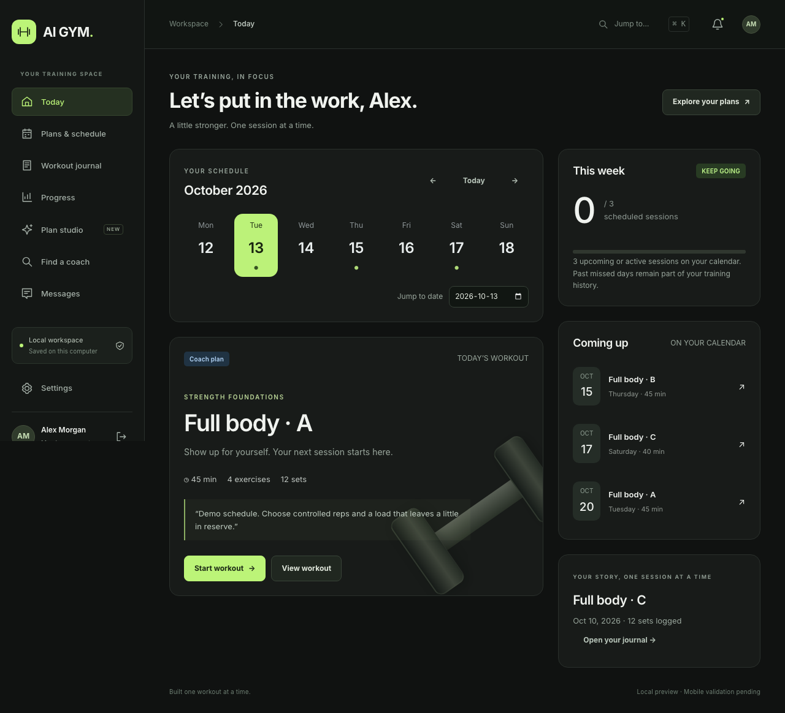

# AI Gym

A digital workout journal where a personal trainer can prescribe, monitor and adjust a member's training plan, and the member can follow it, log every set and see their progress without losing work.

It's for independent trainers who coach a small group of clients and want something more structured than spreadsheets and chat threads, and for members who train on their own and want a reliable plan and journal. I started it in April 2026 because I train regularly and wanted a coaching loop I could actually trust: an Expo/React Native app first, then this web-first iteration that runs fully on one machine.



## Built with

- **Expo SDK 54, React Native 0.81, React 19, TypeScript** with Expo Router (native app plus a dedicated web entry)
- **Node.js local API** (`server/`) with validation, role/ownership authorization and atomic JSON storage
- **Supabase** (Postgres, Auth, row-level security, Edge Functions) for the hosted native path, Zustand for client state
- **Playwright** for browser journeys, `node --test` for API and domain tests, Prettier

## Status

The web iteration runs locally with no Supabase or hosting account: member and trainer workspaces, scheduling, durable workout logging, coaching feedback, messages and progress. Hosted AI plan generation, payments, push notifications and app-store builds are not connected yet. What comes next is in [ROADMAP.md](ROADMAP.md) and the open GitHub issues.

## Open the web app

Use Node 20.19+ and Yarn 4.4.1:

```bash
corepack enable
yarn install
yarn web:build
yarn web:serve
```

Open **http://127.0.0.1:8094**. The sign-in screen has demo buttons for both roles:

| Workspace | Email | Password |
| --- | --- | --- |
| Member — Alex Morgan | `member@aigym.local` | `TrainToday!2026` |
| Trainer — Jordan Lee | `trainer@aigym.local` | `TrainToday!2026` |

Register separate local accounts for an empty starting point. Demo accounts contain fictional records. Sessions are scoped to a browser tab, so separate tabs can explore both roles.

For hot reload, run `yarn web:dev` and open http://localhost:8093. This starts the API on 8094 and Expo on 8093; stop an existing `web:serve` process first. Ctrl+C stops both development processes.

## What works locally

- Registration, sign-in/out, profile intake, password changes, account export and deletion.
- Programs/routines with exercise search, reps, decimal kg/lb loads, timed sets, rest, warmups and groups; editing, copying, reordering, archiving, deletion and draft recovery.
- Scheduling with routine-to-weekday mappings, dated recurrence, conflict review, rescheduling, skipping and future cancellation.
- Workout start/pause/resume/restart/cancel, rest timers, reflections, journal editing, coach feedback and progress charts.
- Durable owner-specific workout drafts and outbox; failed completions remain visible and replay with the same id. Recovery backup download is available.
- Trainer discovery, consent-based connections, existing-account invitations, client management, adherence, coach notes, feedback and program endorsement.
- Persistent messages and in-app notifications with cross-tab/polling updates.
- Editable local-template plan studio, clearly identified as a preview without hosted AI calls.

## Storage and boundaries

The API binds to loopback. It atomically saves `.local-web/data.json`, with hashed passwords and session tokens. Browser drafts, pending completions and cached state have owner-specific keys. These directories are ignored by Git. Keep local data private and back it up before changing storage.

The API enforces role, ownership and active coaching consent independently of the UI. The JSON store supports one local process; it is not a multi-instance hosted database. Server restarts preserve records. Tests use isolated disposable data.

Hosted AI, Supabase, verified email/recovery, payments, push and app-store distribution are **not connected in this iteration**. All local features are available without a purchase. Responsive browser tests do not certify native iOS/Android behavior.

## Verification

```bash
yarn typecheck
yarn test:server
yarn test:member
yarn web:build
yarn exec playwright install chromium
yarn test:web
```

Browser tests use port 8095 and their own temporary data. Traces/screenshots and the HTML report are generated in ignored directories. See [the test guide](tests/web/README.md) and [verification record](docs/web-verification.md).

## Code map

| Path | Purpose |
| --- | --- |
| `app/_layout.web.tsx` | Dedicated web entry through Expo Router |
| `web/` | Typed web UI, API client, responsive CSS and workout recovery |
| `server/` | Local HTTP API, validation, authorization, durable storage and fixtures |
| `tests/web/` | Browser journeys and responsive checks |
| `app/`, `services/`, `store/` | Existing native app and Supabase integration |

The web UI uses semantic HTML/CSS; native screens retain React Native conventions. The native entry and `App.tsx` remain unchanged.

Read [the web handoff](docs/web-first-handoff.md) for lifecycle rules and release gates. The earlier [audit](docs/end-to-end-audit-2026-10-13.md) and [roadmap](docs/completion-roadmap-2026-10-13.md) describe the pre-implementation native baseline, not a certification of this web iteration or a native release.

## Roadmap

See [ROADMAP.md](ROADMAP.md). In short: harden the account and data foundation, make schedules and offline workouts fully reliable, close the trainer/member coaching loop across devices, add bounded AI plan suggestions that a trainer approves, then ship native builds.

## License

[MIT](LICENSE) © 2026 Bello Mohammed
