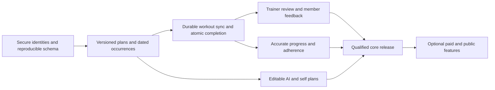

# AI Gym: completion roadmap

**Prepared:** October 13, 2026 · **Baseline:** `feat/a1-reliability` / `f99c24d`

Evidence: [End-to-end audit](end-to-end-audit-2026-10-13.md). Finding IDs A01–A27 below refer to that report.

## Product outcome and scope

Build a dependable training app in which a trainer can prescribe, monitor and adjust a member's plan, and a member can understand, complete and track that plan without losing work. Self-directed and AI-assisted training should use the same reliable program, schedule and workout models.

Planning assumption: **a small beta with trainers and their existing clients comes first**. The launch-target clarification was unanswered when this roadmap was prepared. Public discovery, new-user invitations and paid subscriptions are included as later options. Existing project guidance defers Apple Health, production billing and growth-oriented invite expansion; this audit does not silently activate them.

This roadmap defines three useful completion boundaries:

1. **Private coaching beta:** accounts, accepted relationships, authoring, dated assignments, durable workout logging, member reflection and trainer review work across devices; support, privacy and essential monitoring exist.
2. **Complete core product:** member account/program/history/progress journeys, trainer program lifecycle, bounded AI assistance, accessibility and release operations meet acceptance criteria.
3. **Commercial/public product:** verified subscriptions and/or public marketplace operations, moderation, acquisition invitations and potentially coaching commerce. These require explicit product decisions and their own validation.

“All features” should mean all capabilities inside one of those boundaries pass their acceptance tests. It should not mean accumulating every fitness feature offered by another product.

## Delivery sequence and effort

Estimates are planning ranges for **one experienced full-time engineer**, including focused QA and migration work, with access to test accounts/devices and backend configuration. They are not commitments or measured remaining effort. Hosted-schema drift and the scheduling/offline migrations are the largest uncertainties. Part-time calendar duration will be longer. Re-estimate after Phase 0; store review and beta observation time are additional.

| Phase | Outcome | Indicative active effort | Depends on | Exit |
|---|---|---:|---|---|
| 0 | Reproducible, secure account foundation | 1–2 weeks | Hosted-state inventory and baseline fixtures | No unauthorized cross-user access; auth and clean setup reliable |
| 1 | Correct schedules and durable workouts | 2–3 weeks | Phase 0 | Offline work survives and recurrence behaves correctly |
| 2 | Complete trainer/member coaching loop | 2–3 weeks | Phase 1; authoring UI can start earlier | Two-device four-week coaching scenario passes |
| 3 | Complete member experience and bounded AI | 2–4 weeks | Stable program/history model | Full program/history/account/AI journeys work |
| 4 | Release qualification and operations | 1–2 weeks | Ongoing checks from Phase 0; Phases 1–3 complete | Native release candidate meets quality/privacy/support gates |
| 5 | Optional commercial/public expansion | 3–5+ weeks | Core retained usage; chosen business model | Paid/public flows tested end to end |

**Core product planning envelope: approximately 8–14 engineering weeks.** A narrower private pilot can be considered after Phases 0–2, approximately 5–8 weeks, only if the relevant privacy, accessibility, monitoring and device gates from Phase 4 have already passed. Phase 5 adds roughly 3–5+ weeks and can grow substantially if booking, coaching payments and payouts are selected together.

The critical dependency is data correctness:

QA, privacy and observability begin in Phase 0; the Phase 4 label denotes final qualification, not the first time they are considered.

## Phase 0 — Establish a trustworthy foundation

Primary ownership: backend/auth engineering, with mobile support. Every item is required before real member data is used in the affected feature.

| ID | Deliverable | Acceptance criterion | Evidence |
|---|---|---|---|
| F01 | Inventory deployed schema, functions, grants, Auth settings and migration history; document environment boundaries | Read-only inventory reconciles hosted state against the repository; unknowns are recorded, not filled from the old handoff | A06, A25 |
| F02 | Complete ordered migrations, local config, fixtures and generated database types | Blank disposable database and existing-version upgrade both succeed; all referenced tables/columns/RPCs/triggers exist; registration and core CRUD contract tests pass | A06 |
| F03 | Consent-based relationship API and policies | Unrelated users cannot activate links or read private data; valid request/accept/revoke works; pending state reveals only intended metadata | A01, A12 |
| F04 | Separate editable profiles from roles, entitlements, usage and ratings; restrict privileged functions | Direct self-upgrade/admin/role/rating/usage writes fail; anonymous/authenticated usage RPC calls fail; required service operations work | A02, A03 |
| F05 | Centralize auth lifecycle and error recovery | Sign-in/signup/restore/refresh/resume/logout never wait indefinitely; auth callback does not await dependent Supabase operations | A04 |
| F06 | User-scoped local state and guarded navigation | Delayed A-account requests cannot commit after B signs in; protected deep links require the correct role; no cached private state after logout | A05 |
| F07 | Finish supported email verification/reset paths and remove incomplete auth controls from beta | Confirmed/unconfirmed email signup, resend, expired reset link and successful reset work; social/OTP/biometric controls are either complete or hidden | A18 |
| F08 | Align Expo dependencies; triage advisory report; correct `.env.example` and setup docs | Immutable install, typecheck, SDK compatibility check and all-platform export pass; each relevant advisory has a fix or documented exposure disposition | A25 |
| F09 | Start CI, policy tests and operational error reporting | CI checks type/lint/domain tests/database contracts; fatal auth/sync/backend failures are visible with redacted diagnostics and release version | A26 |
| F10 | Wire release capability gates | Incomplete AI, marketplace, payments and auth options are genuinely disabled when their gate is off; configuration mismatch produces a useful startup/error state | A15, A23, A25 |

Build policy fixtures around anonymous, service, two unrelated trainers and two unrelated members, with pending/active/revoked relationships. Test both allowed and denied operations, including column changes and direct API requests; a passing happy-path UI test is insufficient.

Do not apply the existing SQL sequence unchanged to production. The first schema task is reconstruction and testing, followed by a reviewed staging migration. Billing keys or a `production` label must not substitute for a release gate.

## Phase 1 — Make training records and schedules reliable

Primary ownership: mobile state/sync and database engineering together. Agree on the model before completing UI that depends on it.

### Minimum domain changes

The implementation names below are proposals, not existing tables:

| Model | Required responsibility |
|---|---|
| Program/routine revision | Editable drafts and published revisions; origin, ownership and visibility are explicit |
| Program enrollment/assignment template | Who receives which revision, start/end dates, recurrence and timezone |
| Workout occurrence | A dated prescribed workout with its own planned/in-progress/completed/skipped/cancelled state; overdue can be derived |
| Workout session/completion | Stable client-generated ID, member owner, optional occurrence ID, prescribed snapshot, actual sets, reflection and timestamps |
| Pending operation/outbox | Durable per-user actions, operation IDs, retry state, acknowledgement and conflict handling |
| Recipient notification | Recipient, event/occurrence reference, read state and deduplication key |

Keep the existing JSON exercise payload where practical, but validate/version it and attach stable exercise identities. A wholesale normalization or cloud migration is not a prerequisite. Server-side completion must create/update a workout and its occurrence consistently; notification emission can use a transactional event/outbox pattern.

| ID | Deliverable | Acceptance criterion | Dependency / evidence |
|---|---|---|---|
| D01 | Dated occurrence and recurrence model, migration strategy | Completing Monday preserves Wednesday/Friday and the next week; start/end dates, timezone and DST behavior are explicit; legacy global statuses are not invented into false dated history | F02–F04; A08 |
| D02 | Routine-to-day/week mapping and conflict preview | Push/Pull/Legs maps correctly to Mon/Wed/Fri; conflicts expose a choice; saved calendar matches preview; retries cannot create partial schedules | D01; A09 |
| D03 | Stable session IDs, owner IDs, durable outbox and visible sync state | Offline completion/edit survives process death and reconnect, saves once, and remains visibly pending until acknowledged; account isolation holds | F05–F06; A07 |
| D04 | Atomic completion and controlled lifecycle transitions | Duplicate finish/start/cancel requests are idempotent; workout and occurrence cannot silently disagree; partial/empty completion rule is enforced | D01, D03; A07, A13 |
| D05 | Complete history snapshots and reflection persistence | New device reload preserves prescribed/actual sets, coach/self/AI source, names, revision, occurrence and reflection; later program deletion does not alter old results | D01, D04; A10 |
| D06 | Safe workout controls and accurate input/timers | Decimal kg/lb input, finite positive ranges and appropriate reps work; prescribed rest is used; pause/resume/kill recovery is correct; cancel confirms or preserves a recoverable draft | D03; A20 |
| D07 | Edit/reschedule/skip/cancel future occurrences | Change one date or future series deliberately; history is preserved; temporary overrides expire on the correct date and synchronize | D01–D02; A08 |
| D08 | Explicit sync/conflict/error policies and load refresh | Retryable failures never look like empty success; concurrent edits have a visible resolution rule; refresh cannot replace pending work; focus/reconnect revalidates state | D03–D05; A07, A11 |

Migrate conservatively: back up first, preserve original assignment IDs and unknown legacy completion dates, introduce compatibility reads if needed, then move writers. Prove that program deletion, trainer unlinking, account deletion and offline pending work cannot accidentally recreate or erase unauthorized records.

## Phase 2 — Complete the trainer/member coaching loop

Primary ownership: trainer/mobile product engineering with backend support. Existing-account joining is sufficient for this phase; public invitation delivery remains a separate expansion.

| ID | Deliverable | Acceptance criterion | Dependency / evidence |
|---|---|---|---|
| C01 | Trainer setup and usable profile | Trainer completes name/bio/specialties, saves/clears fields, previews intended member-visible content and understands public/private status; no unsupported verification claim | F03–F04; A19, A22, A27 |
| C02 | Relationship inbox and lifecycle on both roles | Both sides see pending/active/declined/revoked; intended recipient accepts, cancels or declines; unlink immediately revokes appropriate private access | F03, D08; A01, A12 |
| C03 | Roster, member intake and private coach notes | Trainer can find/filter active members and inspect goals/experience/equipment/availability; data-sharing purpose is clear; private notes are role-protected | C02; A22 |
| C04 | Complete trainer program/routine lifecycle | Create, edit, duplicate, reorder, save draft, publish and archive; add set-specific reps/load/rest and instructions; modifying future work preserves past snapshots | D01, D05; A22, A27 |
| C05 | Publish/assign/edit a real program | Trainer selects member, revision, start date and routine/day mapping, previews conflicts and submits once; correct coach attribution reaches member | D02, C04; A09, A27 |
| C06 | Member program and occurrence detail | Member previews exercise instructions and prescription, sees coach notes/source, starts the intended occurrence, and can distinguish approved changes from their own substitutions | C05, D06; A17, A22 |
| C07 | Trainer review queue, workout detail and feedback | Dashboard identifies due/missed/completed-unreviewed work; trainer sees planned vs actual sets/weights/reflection, responds, and adjusts future prescriptions; member can reply/check in | D04–D05, C05–C06; A21–A22 |
| C08 | Persistent notification inbox and cross-device refresh | Assign/change/complete/feedback events reach the intended other account; read state persists; reconnect repairs missed events; failures are surfaced | D08, C02, C07; A11 |

The pilot exit scenario is a four-week, three-day/week plan across two real accounts. Complete one workout offline, miss one, reschedule one, update a future routine, send a reflection, have the trainer review it, then revoke the relationship. Expected sessions, completed history and access boundaries must remain correct throughout.

A minimal feedback/check-in thread is sufficient here. Do not make general chat, video hosting, marketplace booking or trainer payouts prerequisites for learning whether coaches use the core workflow.

## Phase 3 — Complete member value and AI-assisted programming

Primary ownership: member/mobile engineering, backend AI engineering and product content review.

| ID | Deliverable | Acceptance criterion | Dependency / evidence |
|---|---|---|---|
| M01 | Training intake and first-workout setup | New member can choose goals, experience, equipment, availability and relevant constraints, understand data sharing, then obtain a suitable starting plan; inputs can be updated | F07, C03, C06 |
| M02 | Complete self/AI program management | Preview full saved program, edit permitted content, duplicate, reorder, schedule, archive/delete; coach-owned prescriptions have clearly different permissions | C04–C06; A17 |
| M03 | Exercise library and prescription depth | Search/filter with clear instructions, stable identities and alternatives; trainer-defined exercises have ownership/visibility; support timed/cardio data only where UI and metrics are complete | D05–D06, C04; A15, A20, A22 |
| M04 | Full history and truthful progress | More than 50 workouts are accessible with pagination/date filters; aggregate totals are correct; exercise trends/PR rules distinguish warmups and measurement type | D05; A21 |
| M05 | Bounded, validated AI generation | Runtime schemas enforce goal/equipment/units/count/ranges; invalid/truncated/unusable output is rejected safely; request cancellation, timeout, retry and evaluation fixtures pass | F04, F10, D01, M01–M03; A15 |
| M06 | Trusted AI usage and cost controls | Atomic reservations enforce quota under concurrency; failures reconcile usage; rate and budget limits, request IDs, latency/error/cost telemetry and a working kill switch exist | F04, M05; A03, A16 |
| M07 | Editable AI review, atomic save and actual trainer approval | Member edits before acceptance; concurrent Save/Regenerate cannot misrepresent saved state; save is idempotent; trainer can inspect/edit/comment and approve a specific revision | M02, M05–M06, C07; A13, A17 |
| M08 | Complete account/settings/preferences | Member edits profile and units; settings actions all work; email/password/account recovery, support/privacy/terms and notification preferences are usable and persistent | F05–F07; A18–A19 |

AI evaluation should include small/large plans, bodyweight-only equipment, unavailable exercise substitutions, missing values, invalid numbers, malformed output, quota boundary/concurrency, provider timeouts and database failure. Evaluate plan completeness, constraint adherence and usefulness with trainer review; do not equate parseable JSON with a useful prescription.

Fitness instructions and generated plans should distinguish general training guidance from individualized medical judgment. Collect only useful intake information, explain its use, and do not invent injury-safe recommendations solely from a model response.

## Phase 4 — Qualify a release and support actual users

Primary ownership: release/QA engineering, product owner and backend/mobile maintainers. Bring R01–R04 forward before any real-user pilot.

| ID | Deliverable | Acceptance criterion | Dependency / evidence |
|---|---|---|---|
| R01 | Account export/deletion and privacy controls | User can request export/delete, reauthenticate where needed, see completion status; server removes/anonymizes declared data/media and revokes sessions; pending sync cannot resurrect deleted records | F03–F06, D03–D05; A19 |
| R02 | Accessible critical journeys and responsive forms | VoiceOver/TalkBack, large fonts, small screen and visible keyboard support sign-in, assignment, workout completion and account controls; icon actions announce meaning/state | All exposed core screens; A24 |
| R03 | Useful monitoring and support operations | Crash/error reporting, failed/pending sync count, auth failure, AI latency/cost and relationship/assignment/workout success events are redacted and inspectable; user has a working support route | F09, D08, C08; A26 |
| R04 | Test matrix and internal device builds | iOS and Android native builds pass auth, offline, lifecycle, role and two-device scenarios; critical accessibility paths pass; schema/RLS/AI contract tests run in CI | Phases 0–3 for exposed features; A26 |
| R05 | Performance, delivery and recovery | Correct aggregates on representative datasets, verified indexes/query plans, acceptable device performance, staging promotion, migration recovery and backup restore demonstrated | F02, M04; A21, A26 |
| R06 | Distribution and operational documentation | Build identifiers/profiles, store metadata/privacy declarations/deletion links, screenshots, reviewer accounts and instructions match actual behavior; README/handoff/runbook reflect verified release | R01–R05; A19, A25–A26 |

Suggested pilot: 2–3 trainers with 10–20 consenting members, observed over at least two training weeks after the technical gates pass. These are proposed learning parameters, not existing users or a statistical validation claim.

Suggested release gates:

- Zero open P0 issues; no unresolved P1 issue in an exposed core journey.
- All required permission allow/deny scenarios pass against the deployed staging schema.
- Repeated offline/process-death/reconnect scenarios produce no lost or duplicate workouts.
- A trainer can complete the coaching loop without database edits, relaunch workarounds or developer assistance.
- Every exposed primary action produces a correct outcome, useful recoverable error, or explicit pending state.
- Trial/AI/billing capability gates match the release's actual backend support.
- Native crash-free session rate and sync success are measured; a proposed target is at least 99.5% crash-free sessions, but a tiny pilot sample cannot establish that reliability on its own.
- Support ownership, backup/restore and migration recovery are demonstrated, not just documented.

Track activation (accepted relationship + first assigned workout), planned occurrence completion, weekly member/trainer activity, time to trainer review, unsynced operations and reports of lost work. Do not optimize growth metrics before the core records are trustworthy.

## Phase 5 — Optional commercial and public product

These complete plausible business models; they are not all mandatory for the same product. Choose the model before implementation. A subscription to the app does not automatically pay a coach.

| ID | Capability | Completion criterion | Prerequisites |
|---|---|---|---|
| P01 | App Premium subscription | Correct products/localized prices and renewal terms; purchase/cancel/restore/expire/refund/grace cases tested; authenticated idempotent backend reconciliation; user can manage subscription | F04, M06, R04; A23 |
| P02 | Public trainer discovery and reviews | Reproducible search RPCs/pagination, public-only profile fields, verified relationship eligibility for reviews, server ratings, reporting/blocking/moderation/support | C01–C03, R01–R03; A06, A14 |
| P03 | New-user acquisition invitations | Secure expiring single-use links, accept after verified signup, resend/revoke/rate limits and delivery failures; no automatic consent bypass | F03, F07, C02; explicitly deferred growth scope |
| P04 | Full messaging and media feedback | Persistent two-way messages, unread/read state, attachment access control, opt-in push/quiet hours, failed upload/delivery retry, reporting and retention handling | C07–C08, R01–R03 |
| P05 | Trainer packages, booking and coaching commerce | Clear service/pricing/availability; member books/pays; trainer delivers; cancel/refund/dispute/payout/receipt/support flows work and are reconciled | Business-model/payment-policy decisions, R01–R06 |
| P06 | Operator administration | Audited account/relationship support, moderation queue, entitlement reconciliation, AI usage controls and privacy request handling; least-privilege operator access | F04, R01–R03, selected P features |

Before subscription release, choose who pays (member, trainer, or both), what is metered and when a trial starts. Current automatic first-login trial and historical post-free-generation trial descriptions conflict. Resolve that once in product rules and enforce it server-side.

For public user-generated reviews or messaging, include reporting/moderation in the feature definition; current [Apple review guidelines](https://developer.apple.com/app-store/review/guidelines/) are a release reference. For account deletion, follow [Apple](https://developer.apple.com/help/app-review/guideline-reference/5-1-1-account-deletion/) and [Google Play](https://support.google.com/googleplay/android-developer/answer/13327111?hl=en-EN) requirements. Store payment rules and market/jurisdiction details must be checked when the actual offering is selected.

## Explicitly deferred product extensions

| Extension | Why it is deferred / trigger to reconsider |
|---|---|
| Apple Health | Existing project constraint; outside this roadmap's committed work |
| Other wearables/health integrations | Add only after a specific member need and reliable core sync are established |
| Nutrition/macros/meal planning | A separate product and content scope; not required to complete the current strength/coaching promise |
| Progress photos/body measurements | Optional for selected coaching goals; require explicit privacy, storage, deletion and viewing rules |
| Voice coaching and live video | Add after logging and instruction usability are validated; PRD mention alone does not make this a launch requirement |
| Social feeds/challenges/gamification | Retention experiment after actual training behavior is measurable |
| Trainer teams/gyms/organizations | Requires organization tenancy, delegated roles and business demand |
| Desktop trainer portal | Useful if coaches struggle with mobile authoring/roster work; validate before building a second frontend |
| Autonomous AI progression | Requires trustworthy longitudinal data, evaluation and trainer/member controls first |
| Trainer-as-member role switching | Decide whether trainers need their own workouts in the same account; do not force a dual-role redesign without that use case |

## Required end-to-end verification matrix

| Scenario | Expected result |
|---|---|
| New member/trainer signup, confirmed and unconfirmed email | Appropriate verification/session state; no stuck spinner |
| Cold start, expired token, refresh while querying, network failure | Bounded state transition with retry; no deadlock or stale role |
| User A delayed query → logout → user B login | A data cannot appear in B state or storage |
| Anonymous/unrelated/linked/revoked actors call APIs directly | Correct allow/deny for rows, fields, RPCs and transitions |
| Request, accept, decline, cancel and unlink on separate devices | Consistent relationship state; consent and revocation enforced |
| Create/edit/duplicate/archive trainer program | Changes refresh immediately; origin/visibility and historical snapshots stay correct |
| Three routines over four weeks | Correct mapping, no first-completion collapse, correct week/timezone rollover |
| Assign duplicate taps or retry after timeout | One assignment operation; no partial schedule |
| Workout offline → finish → kill → restart → reconnect | One complete attributed server record; pending state disappears only after acknowledgement |
| Finish succeeds but response is lost | Idempotent retry; no double-count or duplicate completion |
| Edit history offline, then refresh on another device | Defined conflict behavior, no silently discarded edit |
| Weight decimal/localized input/kg↔lb and timed exercise | Intended values/prescriptions preserved; no invalid quantities |
| Pause/rest/background/resume/restart/cancel/partial finish | Accurate elapsed/rest behavior and deliberate preservation/discard rules |
| Reflect → trainer reads → trainer responds → member sees feedback | Same attributable record and persistent cross-device feedback |
| AI invalid output/provider timeout/profile failure/concurrent cap requests | Safe rejection/recovery, bounded cost and correct quota |
| AI save fails midway or is retried | Atomic single plan; no orphan or duplicated program |
| More than 50 member and 1,000 roster workouts | Full history and correct aggregates without arbitrary truncation |
| Notification denied, reconnect, duplicate delivery, read on another device | Core flow still works; inbox state reconciles; preferences respected |
| Account export/delete with relationships and pending operations | Declared data result, revoked access and no resurrection |
| Purchase/restore/expiry/refund/replayed webhook, when enabled | Correct trusted entitlement and honest displayed price/status |
| Screen readers/large text/keyboard/small screens | All critical actions discoverable and operable |
| Upgrade schema/app then rollback or restore exercise | Documented compatible recovery with preserved training data |

## First implementation batch

Start with **F01–F06**, with F08/F09 alongside them. Concretely: inventory and reconstruct the backend, repair auth loading/callback behavior, enforce relationship consent and sensitive-field protection, and isolate user state. These resolve the highest-risk existing behavior and create an environment where subsequent changes can be tested.

Next agree on D01's occurrence/history model, then implement D03/D04 durable completion. Do not build adherence dashboards on the current global assignment status, or enable paid AI against client-writable entitlements.

At the end of Phase 0, replace the broad estimates with issue-level estimates using the verified hosted-schema delta. Mark tasks complete only when their acceptance evidence is recorded: code merged, migration applied to the intended test environment, automated checks passed, and required device/cross-account scenarios observed.
