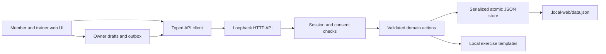

# Web-first handoff — October 13, 2026

## Scope

The owner authorized a complete local web iteration before Supabase and mobile hosting. This implements the trainer/member product loop with local persistence and authorization, preserving the dark digital-journal direction. Live provider integrations and native-device verification remain separate release work.

The web-specific Expo layout renders `web/` through semantic HTML, responsive CSS and hash navigation. Native screens remain available and do not use the local backend. A web fix does not automatically repair the equivalent audited native behavior.

## Product acceptance map

| Area | Local implementation | External or future work |
| --- | --- | --- |
| Accounts | Registration, hashed credentials, tab sessions, intake, units, password change, export, delete | Hosted identity, verified email/recovery, provider sign-in |
| Programs | Program/routine editor, exercise search/cues, prescription, timed sets, warmups/groups, copying, reordering, archive/delete, drafts | Exercise media and a larger curated catalog |
| Scheduling | Dated recurrence, day mapping, duration, duplicate/conflict review, reschedule, skip/restore, future cancellation | Hosted transactions and a distributed-user time-zone policy |
| Execution | Start/pause/resume/restart/cancel, actual sets, rest timers, reflection, partial completion, duration correction | Native haptics/background behavior and device testing |
| Reliability | Stable completion ids, disk transactions, owner outbox, retry/reload recovery, backup download | Cross-device sync and hosted transactional equivalent |
| History | Prescribed snapshots, editable actual records/reflections, eligible coach feedback, source attribution | Hosted audit-event/retention policy |
| Progress | Completed sessions, working-set volume, exercise records and charts from logs | Advanced analytics and health integrations |
| Coaching | Consent, existing-account invitations, roster, adherence, private notes, assignments, feedback | New-user email funnel, organizations/team accounts |
| Discovery | Public profiles, specialties/search, eligible reviews | Verification/moderation operations for public launch |
| Communication | Persistent messages/notifications, refresh/retry, polling and cross-tab signals | Hosted realtime, email and push |
| Plan studio | Equipment-aware local templates, unsaved previews, editing/save, provenance, endorsement | Real AI provider, quotas/budgets and output evaluation |
| Commercial | Explicit capability state; all local functionality accessible | Payment provider, webhooks, entitlements, receipts/refunds |
| Support/privacy | Working information dialogs and account controls | Operator contact and production terms/retention commitments |

Voice coaching, progress photos, Apple Health, advanced growth and a dedicated owner dashboard remain separate product decisions. No local screen represents those services as activated.

## Lifecycle rules

1. Templates and scheduled work are separate. Assignment captures program revision and routine snapshots. Template edits/deletion do not rewrite the member's historical record.
2. Every recurring date is an occurrence. Completing one does not complete later weeks. Completion ids are replay-safe; another id cannot create a second workout for the same occurrence.
3. Future cancellation preserves past missed/skipped dates and completed workouts. Already-started work remains recoverable. Destructive actions disclose their effects.
4. A coaching connection requires recipient acceptance. Private intake, workouts and assignments require active consent. Disconnection removes ongoing coach access; the member retains their journal.
5. Program visibility is explicit. Private member programs are not exposed as coach-library items. Assigned snapshots remain training records for their recipient.
6. Eligible coaches may write feedback; another coach cannot overwrite it. Private coach notes are excluded from member projections and exports.
7. Browser drafts/outbox belong to the original account. Sign-out retains recovery data, while another account cannot replay it. In-flight responses are checked against identity before applying state or downloading exports.
8. Server action validation enforces shape, bounds, identity and permissions independently of UI visibility. New users have no seeded relationships/workouts.

## Architecture and operation

`server/index.mjs` serves web assets and `/api/*` on port 8094. `AI_GYM_DATA_DIR` changes the data directory; `AI_GYM_PORT` changes the port. No secret or provider account is needed for web functionality. Existing native Expo configuration still supports its previous environment variables.

The API includes login/register/logout, state, action, generation, export and health. Public types live in `web/types.ts`; module boundaries are in `web/CONTRACT.md`. Server modules use Node's built-in HTTP, filesystem and cryptography support.

The store serializes writes, syncs a temporary file and atomically renames it. A process lock prevents simultaneous APIs sharing one directory. Invalid/unsupported data fails without resetting records. Stop the API and copy `data.json` before migrating/resetting storage. Account JSON export is user-readable data, not a full-server restore format; no import feature is claimed.

The API uses loopback binding, local origin/host checks, size limits and throttling. It is a local implementation, not a public multi-instance service.

## Supabase transition

The old six-table schema does not automatically satisfy the new domain. Before switching:

1. Review migrations for dated occurrences, snapshots/revisions, consent states, feedback, message ownership and deletion policy. Migrate representative records in staging.
2. Test RLS with at least two members/two trainers for public profiles, pending/active/revoked consent, private/shared programs, messages, coach notes and exports.
3. Implement transactional completion and assignment creation with unique idempotency constraints; retain the browser outbox owner/replay protocol.
4. Replace transport/auth adapters and test refresh, sign-out, reconnect, stale responses and lost responses after successful commit.
5. Add realtime with reconciliation fallback. Notification delivery is not proof of transaction success.
6. Connect AI, billing, email and push separately. Enable each capability only after its provider workflow passes end-to-end; secrets stay server-side.

These are release gates, not executed migrations or deployments. See [mobile validation](mobile-validation.md) for pending native work. Existing Expo compatibility/dependency findings remain in the original audit.

## Verification

Use the README commands. Test both fictional demo roles and empty registrations. The browser suite runs against disposable server data and should be run after building current source. Actual results and screenshots are recorded in [web verification](web-verification.md).

An initial export exposed a legacy Zustand `import.meta` parsing failure in the browser. The Expo web Babel transform now handles that syntax; a successful export alone is not treated as proof of a working page.

Web-specific Supabase and RevenueCat adapters also prevent legacy native imports from requiring hosted settings or initializing payment services. A build with dotenv disabled and Supabase variables unset passes the complete browser suite with no external network attempts.
